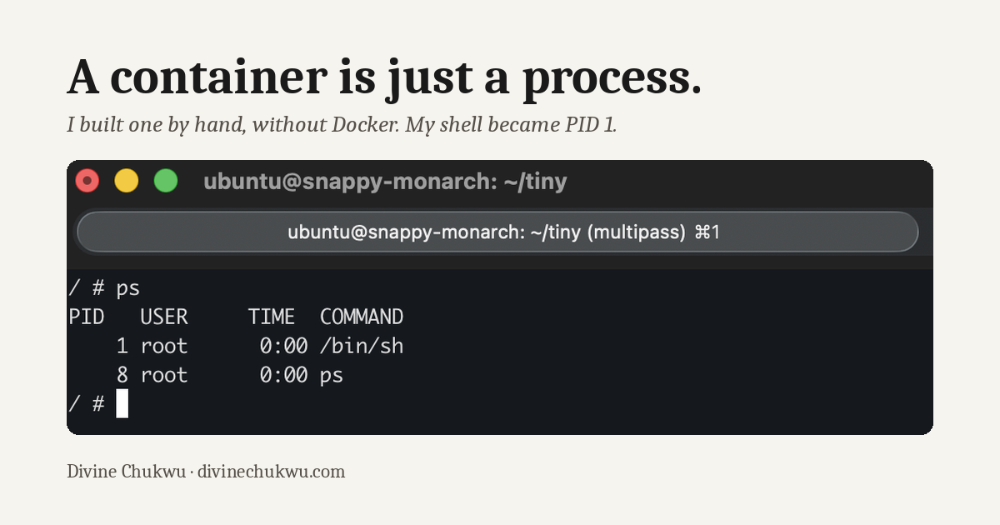
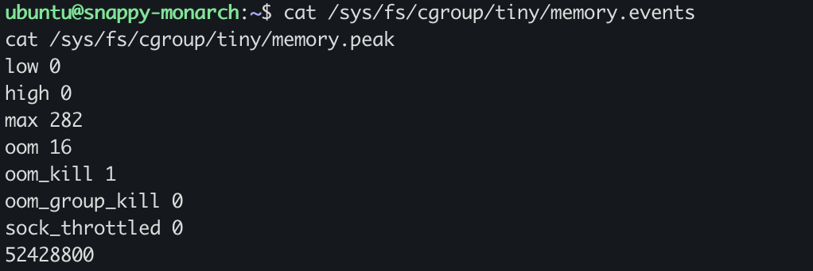

# A container is just a process: I built one by hand



I ran `ps` inside a container I built myself and saw exactly two processes. Then I gave it 50 MB of memory and watched the kernel kill it with exit code 137.

A container is just a process that is isolated and thinks it's alone. There is no "container" object in the Linux kernel. A container is a normal process with three things added:

1. **Its own filesystem**: its own `/`
2. **What it can see**: namespaces
3. **What it can use**: cgroups

Containers have their own filesystem, but they share the host's kernel. To prove all of this to myself, I built one by hand, with no Docker, inside an Ubuntu VM.

The PIDs, paths and version numbers below are from my run. Yours will be different.

## 1. Its own filesystem

### Get a root filesystem

I downloaded Alpine Linux from the official website, the "mini root filesystem", which Alpine describes as being for use in containers and minimal chroots. You need to know which machine you are on first, so you download the right build:

```bash
uname -m
aarch64
```

Then download it with curl:

```bash
curl -O https://dl-cdn.alpinelinux.org/alpine/v3.24/releases/aarch64/alpine-minirootfs-3.24.4-aarch64.tar.gz
```

The `-O` makes sure it is saved with the file name from the server itself, here `alpine-minirootfs-3.24.4-aarch64.tar.gz`. The whole Linux system is about 3.8 MB.

Before going further, check which kernel you are running, so you can prove later that the container shares it:

```bash
uname -r
7.0.0-42-generic
```

Then extract it:

```bash
mkdir rootfs
sudo tar -xzf alpine-minirootfs-3.24.4-aarch64.tar.gz -C rootfs
```

This gives us a plain Alpine filesystem, just a folder. On its own it means nothing and nothing uses it. We need the container to use this rootfs as its own filesystem.

### Give the process its own root with chroot

To give it its own filesystem, you use `chroot` (change root). It sets a new root directory for a process and its children. The shape is `sudo chroot <new root> <command>`, where the command is what runs once the filesystem is in place:

```bash
sudo chroot ./rootfs/ /bin/sh
```

Note that the command path is read *after* the root changes, so it's `/bin/sh`, not `./rootfs/bin/sh`.

This gives you a shell inside the container. Running `ls /` or `ls /bin` now shows the container's own filesystem (the rootfs) rather than the host's:

```sh
/ # cat /etc/os-release
NAME="Alpine Linux"
VERSION_ID=3.24.4
/ # uname -r
7.0.0-42-generic
```

Alpine's files, Ubuntu's kernel. Own filesystem, shared kernel.

## 2. The /proc trap

But at this point you don't have isolation. Running `ps` shows you nothing:

```sh
/ # ps
PID   USER     TIME  COMMAND
```

It looks like an empty container, but the processes are running. You just can't see them. This is because `ps` reads from `/proc`, and `/proc` is empty. The kernel generates `/proc` on demand when it is read, but only once it is mounted. The `/proc` in our rootfs came out of a tarball, so it is just an empty folder.

So we have to mount proc. From inside the container, the command is `mount -t <type> <device> <node>`:

```sh
/ # mount -t proc proc proc
```

- `-t proc`: the type of filesystem, here `proc`
- `proc` (device): proc has no real device or disk behind it, so by convention you just write `proc`
- `proc` (node): where to mount it. I was standing in `/`, so `proc` means `/proc`

The trap is this: the same folder has two names, depending on where you are standing. From the VM, before chroot, the container's proc folder is `~/tiny/rootfs/proc`. From inside the container, after chroot, it's just `/proc`. Mount proc using the wrong name for where you are standing, and it gets mounted somewhere the container can't see. It is mounted, just not where the process is looking. I fell into exactly this trap, which is why I'm writing it down.

## 3. What it can see: namespaces

Now `ps` shows you all the processes the host machine has: systemd, sshd, everything. But for a container to be a container, it has to see just its own processes, with its main process being PID 1.

To do this, we introduce namespaces, specifically the PID namespace, using `unshare` (which runs a command in new namespaces):

```bash
sudo unshare --pid --fork --mount chroot ./rootfs /bin/sh
/ # mount -t proc proc /proc
```

- `--pid`: a new PID namespace. A process can never move itself into a new PID namespace, only its children land there.
- `--fork`: creates that child process and puts it in the new namespace, leaving `unshare` outside as the parent.
- `--mount`: a new mount namespace, so the proc mount stays private to the container. Without it, the mount is still attached on the VM after you exit.

Or you can mount proc from outside, in the unshare step:

```bash
sudo unshare --pid --fork --mount-proc=./rootfs/proc chroot ./rootfs /bin/sh
```

`--mount-proc` implies `--mount`. And this is the trap from section 2 again: `unshare` runs *before* `chroot`, so you have to give it the outside name, `./rootfs/proc`. With no directory, `--mount-proc` mounts on the VM's `/proc`, and `ps` inside stays empty.

Now:

```sh
/ # ps
PID   USER     TIME  COMMAND
    1 root      0:00 /bin/sh
    2 root      0:00 ps
```

Two processes: my shell as PID 1, and `ps` itself. (Every command you run gets the next PID, so if you've run a few commands first, `ps` gets a higher number. In my screenshot it's 8. PID 1 is the part that matters.)

The same `/bin/sh` shell is PID 1 in the container, and in the VM's PID namespace it's just the next free PID, in my case 6939. Same process, two PIDs. To find it from the VM, look through the process tree under `unshare`:

```bash
ps -ejH
   6938   ...   unshare
   6939   ...     sh
```

## 4. What it can use: cgroups

Now we have a partly functional container, with its own filesystem and its own processes. But it still has access to, and can use up, all the memory and CPU of the machine, which isn't ideal. We have to introduce cgroups. These are what let us set limits on our containers.

cgroups live in `/sys/fs/cgroup`, and creating a group is as simple as creating a folder. I created one called `tiny`:

```bash
sudo mkdir /sys/fs/cgroup/tiny
```

The kernel fills it automatically with all the files the cgroup needs, like `memory.max`, `memory.events` and `cgroup.procs`. A fresh group has a clean record. Every counter in `memory.events` starts at zero:

```bash
cat /sys/fs/cgroup/tiny/memory.events
low 0
high 0
max 0
oom 0
oom_kill 0
oom_group_kill 0
sock_throttled 0
```

The file `cgroup.procs` holds the PIDs of all processes that belong to that cgroup. Right now the container is in the same cgroup as its parent `unshare`: my login session's group, `session-29.scope`. We need to set a limit, then move the container into the new group.

The current limit is `max` (no limit). To set a limit of 50 MB, we write to the file:

```bash
echo 50M | sudo tee /sys/fs/cgroup/tiny/memory.max
cat /sys/fs/cgroup/tiny/memory.max
52428800
```

The kernel converts it: 50 × 1024 × 1024 = 52428800 bytes.

This is done outside the container. Then we add the container's PID, from outside, to `cgroup.procs`:

```bash
echo 6939 | sudo tee /sys/fs/cgroup/tiny/cgroup.procs
```

This moves the process from its original cgroup to this one. It's a move, not a copy. Now the container is memory limited.

## 5. Break the limit

You can test it by running a command that uses more memory than the limit you set:

```sh
/ # sh -c 'a=$(yes | head -c 100000000)'
Killed
/ # echo $?
137
```

`yes` prints `y` forever, `head -c` keeps 100 MB, and `$( )` holds it all in memory, in a child shell so the container's PID 1 survives.

When you run it, you see `Killed` printed in the terminal. Before the kill, the kernel tries to reclaim memory, and after trying unsuccessfully, it kills the process with exit code 137 (128 + 9, SIGKILL). `OOMKilled` is how Kubernetes labels that same kill. This is exactly what happens in Kubernetes when your Pod goes over its memory limit: the limit in your Pod spec becomes `memory.max` on the node.

Looking at the cgroup's files after the kill shows it. Compare this with the all-zero record from before:

```bash
cat /sys/fs/cgroup/tiny/memory.events
low 0
high 0
max 282
oom 16
oom_kill 1
oom_group_kill 0
sock_throttled 0

cat /sys/fs/cgroup/tiny/memory.peak
52428800
```



*The real output from my VM.*

`max 282`: the group hit its limit 282 times, and each time the kernel tried to reclaim memory. `oom_kill 1`: in the end it killed one process. And `memory.peak` is exactly 52428800: the group never went one byte over the limit.

## So what?

Most people use containers but have never looked underneath them. This matters because when you hit an issue, say your task dies with exit code 137, you know what happened and how to check it: find the cgroup, read `memory.events`, and see whether `oom_kill` went up.

You also don't have to do any of this by hand in real life. runc, the tool Docker and Kubernetes use underneath, does these same steps for you: a new root, namespaces, cgroup limits.

## What's next

This container is a toy, and I know where it ends. It still uses `chroot`, which a root process can escape. Real runtimes use `pivot_root`. It has no network, no hostname of its own, and no user namespace, so root inside is still root on the VM. And there's no seccomp or dropped capabilities limiting what it can do.

Next, I'm running a Pod in a kind cluster and finding its process on the node, to see the same pieces from the other side.
